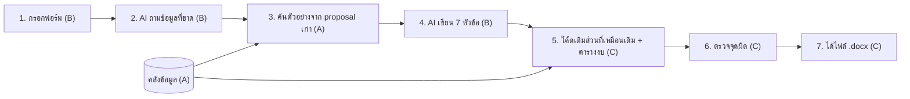

# Proposal Writer: ใครทำอะไร ภายใน 20 พ.ย.

เอกสารนี้บอกว่าเราสามคนต้องทำอะไรกันบ้าง เพื่อให้วันที่ 20 พ.ย. เรามีแอปที่กรอกฟอร์มสั้น ๆ แล้วได้ proposal กิจกรรมชมรม BizComp ฉบับสมบูรณ์ออกมาเป็นไฟล์ Word พร้อมเซ็น

แอปนี้ต่อยอดจากแอปแชทที่เรามีใน repo อยู่แล้ว ซึ่งใช้ Ollama (โปรแกรมที่รันโมเดล AI บนเครื่องตัวเอง)

## ภาพรวม: แอปทำงานยังไง



ทำไมแบ่งแบบนี้: proposal ของชมรมทุกฉบับใช้แบบฟอร์ม CSII เดียวกัน ประมาณครึ่งหนึ่งเป็นข้อความเดิมทุกครั้ง เช่น หัวกระดาษ รายชื่อกรรมการ KPI ของคณะ และ checklist ส่วนนี้ให้โค้ดเติมเอง เพราะเร็วกว่าและไม่ผิด ส่วน AI เขียนเฉพาะส่วนที่ต้องคิดเนื้อหาใหม่ทุกครั้ง โดยดูตัวอย่างจาก proposal เก่า ตัวเลขทุกตัวให้โค้ดคำนวณ ไม่ให้ AI คิดเลขเอง

### ตัวอย่าง: ถ้าทำ proposal ของ Inclusive Workshop 2 ด้วยแอปนี้

1. **ผู้ใช้กรอกฟอร์ม:** ชื่องาน "BizComp Inclusive Workshop 2" · workshop เปิดทั่วไป · 12 ต.ค. 16:30–18:30 · ห้อง 301 จามจุรี 10 · นิสิต BAScii 25 คน สมาชิก 25 คน mentor 1 คน · ในงานมี แนะนำชมรม, รู้จักการแข่ง case, โครงสร้าง pitch deck, การทำงานเป็นทีม, mini case เป็นกลุ่ม · งบ ค่าห้องล่วงเวลา 120 บาท × 2 ชม., ปากกา 230 บาท, post-it 129 บาท, แก้วที่ระลึก mentor 500 บาท · ชื่อผู้เสนอ
2. **AI ถามกลับ** สิ่งที่ฟอร์มไม่ได้บอก เช่น "เป้าจำนวนคนเข้าขั้นต่ำเท่าไหร่" ถ้าไม่ตอบ ในไฟล์จะขึ้น `[TO CONFIRM: ...]` ให้คนมาเติม AI จะไม่เดาเอง
3. **ระบบค้น** หัวข้อ Introduction จาก proposal เก่าที่คล้ายที่สุด เช่น Inclusive Workshop 1 กับ Members Only Workshop 1 เพื่อใช้เป็นตัวอย่างสำนวน
4. **AI เขียน** Introduction, Objectives, Benefits, Activity KPIs, Desired Characteristics (เลือกช่องที่จะติ๊ก และเขียนคำอธิบาย), Schedule และ Facilities
5. **โค้ดเติม** หัวกระดาษ ประเภทกิจกรรม KPI ของคณะ รายชื่อกรรมการ รหัสกองทุน และตารางงบ โค้ดคำนวณยอดรวมเอง ได้ 240 + 359 + 500 = **1,099 บาท** พร้อมเขียนยอดเป็นตัวอักษร
6. **ตรวจจุดผิด** เช่น ปากกา 30 ด้ามแต่คนเข้า 51 คน แอปจะเตือนก่อนดาวน์โหลด
7. **ได้ไฟล์ .docx** ที่เหลือแค่ตรวจทานแล้วเซ็น

(ใน proposal ตัวจริงเขียนยอดรวมไว้ 1,100 บาท ซึ่งไม่ตรงกับผลรวมจริง ดูภาคผนวก ง)

### ใครทำอะไร

| คน | ทำอะไร | เสร็จเมื่อ |
|---|---|---|
| **A: คลังข้อมูล (บูม)** | รวบรวมไฟล์ทั้งหมด ตัดเป็นท่อน และทำระบบค้น | ขอหัวข้อไหนจาก proposal ที่คล้ายที่สุด ก็ได้หัวข้อนั้นกลับมาถูก |
| **B: ฟอร์มและตัวเขียน (ย่วย)** | ทำหน้าฟอร์ม และทุกอย่างที่ AI เขียน | กรอกฟอร์มแล้วได้ข้อความครบ 7 หัวข้อ โดยไม่มีข้อมูลที่ AI แต่งเอง |
| **C: ประกอบร่าง (หมิง)** | เชื่อมทุกส่วน, โค้ดเติมส่วนที่เหมือนเดิม, ตารางงบ, ตัวตรวจ, ไฟล์ Word, วัดผล | กดปุ่มเดียวได้ .docx ตามแบบฟอร์ม CSII และมีตารางผลการวัด |

**สิ่งที่ต้องตกลงร่วมกันก่อนแยกทำ (ภายใน 12 พ.ย.):** รูปแบบของ "ใบสรุปงาน" (event brief) ซึ่งเป็นข้อมูลก้อนเดียวที่ทั้งสามส่วนส่งต่อกัน B สร้างจากฟอร์ม เติมข้อความที่ AI เขียนลงไป แล้ว C เอาไปประกอบเป็นไฟล์ ร่างไว้ในภาคผนวก ข แล้ว

## A: คลังข้อมูลและการค้น (บูม)

**ส่ง:** ไฟล์ทั้งหมดที่แอปใช้ และระบบค้นที่ดึงหัวข้อที่ต้องการจาก proposal เก่าได้

**เสร็จเมื่อ:** ขอ "Introduction ของ workshop" แล้วได้ Introduction จาก proposal ที่คล้ายที่สุด 2–3 ฉบับ และไม่มีหัวข้ออื่นปนมา

**ต้องได้จากใคร:** ไม่ต้องรอใคร A เริ่มก่อนได้เลย และเป็นคนที่คนอื่นรอ

**ขั้นตอน** (ข้อแรก ๆ สำคัญสุด)

- **A1** ไฟล์ทั้งหมดอยู่ในโฟลเดอร์ `3-data-do-not-commit/` ของแพ็กนี้แล้ว งานของ A คือตรวจ `club-facts.md` ที่เพชรร่างจาก proposal เก่า เติมช่อง `[TODO]` และแก้ข้อมูลที่ไม่เป็นปัจจุบัน จากนั้นแต่ง proposal ปลอมหนึ่งฉบับไว้ใน repo สำหรับทดสอบ
- **A2** ให้แอปตัด proposal ตามหัวข้อ (1. Introduction, 2. Objectives …) แทนการตัดทุก 900 ตัวอักษรแบบตอนนี้ แล้วติดป้ายแต่ละท่อน (chunk) ว่ามาจากหัวข้อไหน งานอะไร และงานประเภทไหน
- **A3** ทำระบบค้นที่เลือกหัวข้อได้ เช่น "ขอ Introduction ของงานที่คล้ายงานนี้ 3 อัน" เสร็จภายใน 14 พ.ย. เพราะ B ต้องใช้
- **A4** ให้แอปอ่านไฟล์ข้อมูลชมรมเป็นข้อมูลที่โค้ดหยิบใช้ได้ตรง ๆ เช่น รายชื่อกรรมการ หรืองบที่เหลือ เพราะ C ต้องใช้เติมส่วนที่เหมือนเดิม
- **A5** ลองค้นด้วยคำถามตัวอย่าง 5 คำถาม แล้วจดว่าได้ผลถูกกี่ข้อ (ถ้าผลไม่ดี ลองเปลี่ยนโมเดลที่ใช้ค้น)

## B: ฟอร์มและตัวเขียน (ย่วย)

**ส่ง:** หน้าฟอร์ม และขั้นที่ AI ถามกลับกับเขียน 7 หัวข้อ

**เสร็จเมื่อ:** กรอกฟอร์มของงานทดสอบแล้วได้ข้อความครบ 7 หัวข้อ และไม่มีชื่อ ตัวเลข หรือวันที่ที่ไม่ได้อยู่ในฟอร์มหรือคลังข้อมูล

**ต้องได้จากใคร:** ระบบค้นจาก A (A3) ภายใน 14 พ.ย. ระหว่างรอ ให้ใช้ตัวอย่างที่ copy มาแปะเองไปก่อน

**ขั้นตอน**

- **B1** ทำหน้าฟอร์ม 7 ช่อง (ชื่องานและประเภท · วันเวลาสถานที่ · คนเข้าแยกกลุ่ม · ในงานมีอะไร 3–5 ข้อ · วิทยากร · รายการงบ · ผู้เสนอ) กดส่งแล้วได้ใบสรุปงานตามรูปแบบที่ตกลงกัน
- **B2** เลือกโมเดล โมเดลที่ใช้อยู่ (`qwen3:1.7b`) เล็กเกินกว่าจะเขียนเอกสารยาวได้ดี ให้ลองตัวใหญ่ขึ้น 2–3 ตัวบนเครื่องที่จะใช้ demo โดยให้ทุกตัวเขียน Introduction เดียวกัน แล้วเลือกตัวที่เขียนดีและเร็วพอ ทำให้เสร็จภายใน 12 พ.ย.
- **B3** เขียน prompt (คำสั่งที่ส่งให้ AI) แยกทีละหัวข้อ แต่ละ prompt ประกอบด้วยใบสรุปงาน ตัวอย่างหัวข้อเดียวกันจาก A และกฎของหัวข้อนั้น เช่น Benefits ต้องโยงกับ KPI ของคณะ และห้ามใส่ตัวเลขงบ
- **B4** ให้ AI เขียนครบ 7 หัวข้อแล้วใส่กลับลงใบสรุปงาน ในหัวข้อ Desired Characteristics ให้ AI ส่งรายชื่อช่องที่ติ๊กมาด้วย คำอธิบายจะได้ตรงกับช่องที่ติ๊ก
- **B5** ขั้นถามกลับ ก่อนเขียน ให้ AI ดูว่าข้อมูลขาดอะไร แล้วถามผู้ใช้ไม่เกิน 3 ข้อ ข้อไหนไม่ได้คำตอบให้ขึ้น `[TO CONFIRM]`

## C: ประกอบร่างและวัดผล (หมิง)

**ส่ง:** แอปที่ทำงานครบตั้งแต่ฟอร์มจนได้ .docx พร้อมตัวตรวจ และตารางผลการวัด

**เสร็จเมื่อ:** รันตัวอย่าง Inclusive Workshop 2 ได้ไฟล์ .docx หน้าตาตามแบบฟอร์ม CSII และมีตารางผลการวัด

**ต้องได้จากใคร:** ไฟล์ข้อมูลชมรมจาก A (A4) และข้อความ 7 หัวข้อจาก B (B4) ระหว่างรอ C ทำส่วนที่โค้ดเติมกับตารางงบไปก่อนได้ โดยใช้ข้อมูลปลอม

**ขั้นตอน**

- **C0** (11 พ.ย. ก่อนคนอื่นเริ่ม) แยก app.py เป็นไฟล์ของแต่ละคน และเตรียม repo ตามหัวข้อ "เริ่มงานวันแรก"
- **C1** ทำไฟล์ Word ต้นแบบ โดยเอา proposal เก่าหนึ่งฉบับที่เป็นไฟล์ Word หรือ Google Doc มาเว้นช่องไว้ให้แอปเติม เช่น `{{event_name}}`
- **C2** โค้ดเติมส่วนที่เหมือนเดิม (หัวกระดาษ ประเภทกิจกรรม KPI ของคณะ รายชื่อกรรมการ รหัสกองทุน ข้อความรับทราบ checklist ภาคผนวก) และตารางงบ (จำนวน × ราคา ยอดรวม ยอดเป็นตัวอักษร งบชมรมที่เหลือ)
- **C3** เชื่อมทุกส่วน กรอกฟอร์ม → AI เขียน → เติม → ปุ่มดาวน์โหลด .docx **ภายใน 16 พ.ย. ต้องรันตัวอย่างได้ครบทุกขั้น**
- **C4** ตัวตรวจ เตือนเมื่อ จำนวนคนแต่ละกลุ่มรวมไม่เท่ายอดรวม · วันที่ใน Schedule ไม่ตรงวันงาน · ชื่องานไม่ตรงกันในแต่ละหัวข้อ · จำนวนอุปกรณ์น้อยกว่าคน
- **C5** วัดผล ซ่อน proposal เก่าทีละฉบับแล้วให้แอปเขียนฉบับนั้นใหม่ เทียบกับของจริง เริ่ม 3 ฉบับ ถ้าทันค่อยทำครบ (รายละเอียดในภาคผนวก ค) ทุกคนช่วยกรอกฟอร์มของฉบับที่ใช้ทดสอบ

## เริ่มงานวันแรก

**หมิงทำก่อน (ภายใน 11 พ.ย. ก่อนส่งแพ็กให้ทีม)**

1. เพิ่ม `data/` ลงใน `.gitignore` ของ repo แล้ว push เพราะแอปเก็บข้อความทั้งหมดของไฟล์ที่อัปโหลดไว้ใน `data/chunks.json` ถ้าไม่กันไว้ เนื้อหา proposal จริงจะหลุดขึ้น repo public
2. ใส่ `docs/SPEC.md` และ `AGENTS.md` ฉบับใหม่ลงใน repo
3. **C0:** แยก `app.py` เป็นไฟล์ของแต่ละคน (ดูตารางด้านล่าง) ให้แต่ละไฟล์มีชื่อฟังก์ชันรอไว้ แล้ว push ทุกคนจะได้เริ่มงานในไฟล์ของตัวเองได้เลยโดยไม่ชนกัน
4. เพิ่มบูมกับย่วยเป็น collaborator ไปที่ repo → Settings → Collaborators → Add people ถ้าไม่เพิ่ม ทั้งสองคนจะ push ไม่ได้
5. ส่งลิงก์ repo และ zip ของแพ็กนี้ให้ทีม

**ทุกคนทำบนเครื่องตัวเอง**

1. Clone repo แล้วทำตาม README ของ repo: ติดตั้ง Ollama, `ollama pull` โมเดล, สร้าง venv แล้วรัน `python app.py`
2. เปิดหน้า Documents ในแอป แล้วอัปโหลดไฟล์จาก `3-data-do-not-commit/` ไฟล์พวกนี้ไม่อยู่ใน repo แต่ละคนต้องอัปโหลดเอง
3. ทำงานเฉพาะไฟล์ของตัวเอง ก่อนเริ่มงานทุกครั้งให้ `git pull` และ push บ่อย ๆ อย่าใช้ `git add .` ให้เลือก add เฉพาะไฟล์ที่ตัวเองแก้

### ใครดูแลไฟล์ไหน

| ไฟล์ | เจ้าของ | มีอะไร |
|---|---|---|
| `knowledge.py` | บูม | อ่านไฟล์, ตัดเป็นท่อน, ค้น, อ่าน club-facts |
| `templates/documents.html`, `static/documents.js` | บูม | หน้าอัปโหลดไฟล์ |
| `writer.py`, `prompts/` | ย่วย | ขั้นที่ AI ถามกลับ, prompt, เรียกโมเดลให้เขียน |
| `templates/new.html`, `static/new.js` | ย่วย | หน้าฟอร์ม |
| `scripts/compare_models.py` | ย่วย | ลองเทียบโมเดล |
| `export.py`, `templates/proposal_template.docx` | หมิง | เติมไฟล์ Word |
| `checker.py` | หมิง | ตรวจจุดผิด |
| `app.py`, `config.py`, `ollama_client.py` | หมิง | route ของทุกหน้า, ค่าตั้งต้น เช่นชื่อโมเดล, และฟังก์ชันเรียก Ollama ที่ทุกคนใช้ร่วมกัน (`ollama_post`) |

ถ้าต้องแก้ไฟล์ของคนอื่น ให้บอกเจ้าของก่อน ถ้าต้องเพิ่ม route ใน `app.py` ให้เขียนเป็นฟังก์ชันสั้น ๆ ที่เรียกฟังก์ชันจากไฟล์ของตัวเอง แล้วบอกหมิง

## วันสำคัญ

| วัน | ต้องได้อะไร |
|---|---|
| 11 พ.ย. | หมิงทำ C0 (แยก app.py) และเตรียม repo ให้พร้อม |
| 12 พ.ย. | ตกลงรูปแบบใบสรุปงาน · B เลือกโมเดลเสร็จ · A แชร์ไฟล์ใน Drive |
| 14 พ.ย. | แต่ละส่วนรันได้ด้วยตัวเอง · ระบบค้นของ A พร้อมให้ B ใช้ |
| **16 พ.ย.** | **จุดเช็ก:** รันตัวอย่างได้ครบตั้งแต่ฟอร์มจนได้ .docx ถ้ายัง ทีมคุยกันว่าจะตัดอะไร |
| 17–18 พ.ย. | วัดผลและแก้ |
| 19 พ.ย. | สคริปต์ demo และสไลด์ |
| 20 พ.ย. | ส่ง |

### เรื่องที่ยังต้องตัดสินใจ

1. วันที่ 20 ต้องส่งอะไร (demo สด, รายงาน, สไลด์?) ตอนนี้ใน MyCourseVille ยังไม่มีงานนี้
2. เครื่องที่ใช้ demo มี RAM เท่าไหร่ ตัวนี้กำหนดว่าใช้โมเดลใหญ่ได้แค่ไหน
3. จะเก็บ web search ไว้ไหม ตอนนี้แอปออกไปค้นที่ ollama.com ถ้าวิชาต้องการให้รันบนเครื่องล้วน ๆ ต้องปิด

### กติกาเรื่องไฟล์

repo ต้องเป็น public และอาจารย์บอกว่าห้ามมี PDF ใน repo **ห้ามเอา proposal จริงหรือไฟล์ข้อมูลชมรมขึ้น git** เพราะมีชื่อคน งบ และรหัสกองทุน ไฟล์จริงอยู่ใน Drive ของกลุ่ม แต่ละคนอัปโหลดเข้าแอปบนเครื่องตัวเอง (แอปเก็บไฟล์ไว้ใน `uploads/` และเก็บข้อความที่ตัดแล้วไว้ใน `data/` ทั้งสองโฟลเดอร์ต้องอยู่ใน .gitignore)

---

## ภาคผนวก ก: คำสั่งสำหรับ Codex

วิธีใช้: copy กล่องของงานตัวเองไปแปะใน Codex ทีละกล่อง ทำเสร็จแล้วลองเช็กตามบรรทัด "Check" ถ้าผ่านค่อย commit แล้วไปกล่องถัดไป คำสั่งเขียนเป็นภาษาอังกฤษ เพราะโค้ดใน repo เป็นภาษาอังกฤษ ทุกกล่องสั่งให้ Codex อ่าน `docs/SPEC.md` และ `AGENTS.md` ก่อน Codex จะได้รู้ว่าไฟล์ไหนเป็นของใคร

**C0 (หมิง · เสร็จแล้ว 10 พ.ย.)**
```
Read AGENTS.md and docs/SPEC.md first. Split app.py into modules without changing behaviour:
config.py (MODEL, EMBED_MODEL, paths, sizes), knowledge.py (extract_document, split_text,
embed_texts, load_index, save_index, cosine_similarity, retrieve_context), and empty modules
writer.py, export.py, checker.py with stub functions: build_brief(form) -> dict,
write_all_sections(brief) -> dict, find_gaps(brief) -> list, fill_docx(brief, facts) -> bytes,
check_brief(brief) -> list. Add load_club_facts() -> dict and search_sections(...) -> list stubs
to knowledge.py. app.py keeps only routes and imports. Add data/ to .gitignore.
Add samples/brief.example.json: the Inclusive Workshop 2 example from SPEC.md as an event
brief, with the proposer as "Sample Proposer".
Check: python app.py still runs, upload and chat still work.
```

**A2 (บูม)**
```
Read AGENTS.md and docs/SPEC.md first. Only edit knowledge.py, templates/documents.html and
static/documents.js (one small change in the upload route of app.py is allowed; tell Ming).
Split uploaded proposals at their numbered section headings (e.g. "1. Introduction",
"2. Objectives") instead of every 900 characters. Store each chunk with: source file, section
name, event name (from the "Activity/Event Name:" line) and event_type (chosen on the upload
page: open workshop / members-only workshop / social event / long project / other).
Split non-proposal files (club facts, CSII rules) the old way, labelled section="reference".
Check: upload a past proposal, open data/chunks.json, each chunk has a section label.
```

**A3 (บูม)**
```
Read AGENTS.md and docs/SPEC.md first. In knowledge.py, implement
search_sections(section, event_type, query, k=3): return the k most similar chunks whose
section matches, preferring the same event_type. Add a route /api/search in app.py that only
calls this function. Check: /api/search?section=Introduction&event_type=open%20workshop&q=case
returns only Introduction chunks.
```

**A4 (บูม)**
```
Read AGENTS.md and docs/SPEC.md first. In knowledge.py, implement load_club_facts() that reads
uploads/club-facts.md and returns a dict. Each "## " heading is a key; Markdown tables become
lists of dicts; "- Key: value" lines become key/value pairs. Add samples/club-facts.example.md
with made-up data so the code runs without the real file.
Check: python -c "from knowledge import load_club_facts; print(load_club_facts())" prints the data.
```

**B1 (ย่วย)**
```
Read AGENTS.md and docs/SPEC.md first (event brief in ภาคผนวก ข). Only edit writer.py,
templates/new.html, static/new.js (add one /new route in app.py; tell Ming). Build a form with:
event name, event type (dropdown), date, time, location, participant groups with counts
(add/remove rows), 3-5 activity bullets, speakers, budget items (item, qty, unit price,
add/remove rows, or "no budget"), proposer (dropdown from load_club_facts() officers).
Implement build_brief(form) in writer.py and save the brief to data/briefs/<id>.json.
Check: fill the form, a JSON file appears with the right values.
```

**B2 (ย่วย)**
```
Read AGENTS.md and docs/SPEC.md first. Write scripts/compare_models.py that sends the same
prompt (write the Introduction for samples/brief.example.json, with two example Introductions)
to each model in a list, and prints the time taken and the text. Check: the script runs for
each model pulled with `ollama pull`. Tell Ming which model to set in config.py.
```

**B3 + B4 (ย่วย)**
```
Read AGENTS.md and docs/SPEC.md first. Only edit writer.py and prompts/. Create
prompts/<section>.txt for: introduction, objectives, benefits, activity_kpis, characteristics,
schedule, facilities. Each prompt gets the event brief, 2-3 examples from
knowledge.search_sections(), and the section rules in ภาคผนวก ข of SPEC.md. Implement
write_section(brief, section) and write_all_sections(brief), which fill brief["sections"].
For characteristics, ask for JSON {"ticked": [...], "explanation": "..."}. Do not use web search.
The model must never write budget numbers. Check: run on samples/brief.example.json, all 7
sections are filled.
```

**B5 (ย่วย)**
```
Read AGENTS.md and docs/SPEC.md first. Only edit writer.py, templates/new.html, static/new.js.
Implement find_gaps(brief): one model call that lists information the sections need but the
brief lacks; show at most 3 questions on the form page. Save answers in
brief["followup_answers"]. Anything unanswered goes to brief["to_confirm"] and appears in the
text as [TO CONFIRM: ...]. Check: leave out the KPI target, the app asks about it.
```

**C1 + C2 (หมิง)**
```
Read AGENTS.md and docs/SPEC.md first. Only edit export.py and templates/proposal_template.docx.
Implement fill_docx(brief, facts) with python-docx, filling placeholders like {{event_name}}.
Fill the fixed parts from load_club_facts() and the brief: header, type of activity, duration,
school KPIs, officer list, fund codes, acknowledgement, checklist, appendix. Build the budget
request table in code: qty x unit price, total, total in English words, and the club budget
table. Never take numbers from the AI text. Check: run on samples/brief.example.json, open the
.docx, totals are correct.
```

**C3 (หมิง)**
```
Read AGENTS.md and docs/SPEC.md first. In app.py, connect the flow: /new form -> find_gaps ->
write_all_sections -> fill_docx -> check_brief -> a "Download .docx" button. Add a link to /new
in the navigation. Check: the Inclusive Workshop 2 example goes from form to downloaded file
without errors.
```

**C4 (หมิง)**
```
Read AGENTS.md and docs/SPEC.md first. Only edit checker.py (and show the result in
templates/new.html, telling Yuay). Implement check_brief(brief) returning a list of warnings:
participant groups do not add up to the total; a Schedule date does not match the event date;
the event name differs between sections; material quantities are lower than the participant
count; any [TO CONFIRM] left. Check: set 30 pens for 51 people, a warning shows.
```

## ภาคผนวก ข: ใบสรุปงาน (event brief)

ข้อมูลก้อนเดียวที่ส่งต่อกันทั้งแอป B สร้างจากฟอร์มและเติม `sections` กับ `to_confirm` ส่วน C อ่านทั้งก้อนแต่ไม่แก้ข้อความที่ AI เขียน

```json
{
  "event_name": "", "event_type": "", "date": "", "time": "", "location": "",
  "participants": [{"group": "", "count": 0}],
  "activities": [""], "speakers": [""],
  "budget_items": [{"item": "", "qty": 0, "unit_price": 0}],
  "proposer": "",
  "followup_answers": {},
  "sections": {"introduction": "", "objectives": [], "benefits": [], "activity_kpis": [],
               "characteristics": {"ticked": [], "explanation": ""}, "schedule": [], "facilities": []},
  "to_confirm": []
}
```

กฎของแต่ละหัวข้อที่ AI เขียน:

- **Introduction:** ปัญหาที่งานนี้แก้ งานทำอะไร ผู้เข้าร่วมได้อะไร 1 ย่อหน้า
- **Objectives:** 4–6 ข้อ ขึ้นต้นด้วยคำกริยา
- **Benefits:** 4–6 ข้อ แต่ละข้อโยงกับ KPI ของคณะอย่างน้อย 1 ข้อ
- **Activity KPIs:** 2–3 ข้อ วัดเป็นตัวเลขได้ เช่น จำนวนคนเข้า หรือคะแนนความพอใจ
- **Desired Characteristics:** ติ๊ก 2–4 ช่อง คำอธิบายพูดถึงทุกช่องที่ติ๊ก และไม่พูดถึงช่องที่ไม่ได้ติ๊ก
- **Schedule:** มีช่วงเตรียมงานด้วย และวันจัดงานต้องตรงกับฟอร์ม
- **Facilities:** อุปกรณ์ที่ใช้ จำนวนต้องพอสำหรับจำนวนคน

## ภาคผนวก ค: วิธีวัดผล

1. เลือก proposal เก่า 3 ฉบับ (ถ้าทันทำครบทุกฉบับ) แต่ละฉบับ ให้กรอกฟอร์มแบบที่จะกรอกจริง ใช้เวลาฉบับละประมาณ 10 นาที
2. เอาฉบับนั้นออกจากแอปก่อน จะได้ไม่ลอกตัวเอง แล้วให้แอปเขียน **ระวัง:** ไฟล์ `workshops-merged` คือ Inclusive Workshop 2 รวมกับ Members Only Workshop 1 ในฉบับเดียว ถ้าซ่อนสองฉบับนี้ ต้องซ่อน merged ด้วย ไม่งั้นแอปจะไปลอกจาก merged
3. ให้คะแนน:
   - **ครบไหม:** มีครบ 12 หัวข้อ (โค้ดนับให้)
   - **แต่งข้อมูลเองไหม:** ทุกชื่อ ตัวเลข และวันที่ต้องมีอยู่ในฟอร์มหรือคลังข้อมูล
   - **งบถูกไหม:** ยอดรวมทุกจุดถูก
   - **เขียนดีไหม:** ให้คนในชมรม 2–3 คนให้คะแนน 1–5 เรื่องความชัด ความเฉพาะเจาะจง และความน่าโน้มน้าว โดยวางคู่กับของจริงแบบไม่บอกว่าอันไหนเป็นอันไหน แล้วถามด้วยว่าเดาว่าอันไหน AI เขียน
   - **ประหยัดแรงไหม:** จำนวนช่องที่ต้องกรอกและเวลาที่ใช้ เทียบกับเขียนเองทั้งฉบับ

## ภาคผนวก ง: proposal จริงก็มีจุดผิด

เป้าหมายจึงไม่ใช่ "ให้เหมือนของจริงเป๊ะ" ใน Inclusive Workshop 2 มีจุดผิด 4 จุด:
- Introduction เขียนว่า "The First Inclusive Workshop" ทั้งที่เป็นครั้งที่ 2
- หน้าแรกบอกวันที่ 12 ต.ค. แต่ Schedule บอกสัปดาห์ที่ 3 ของ ต.ค.
- รายการงบรวมได้ 1,099 บาท แต่ยอดรวมที่เขียนคือ 1,100
- ขอปากกา 30 ด้ามสำหรับคน 51 คน

RealBiz ก็มีจุดผิดเหมือนกัน รายการงบรวมได้ 29,710 บาท แต่ยอดรวมที่เขียนคือ 30,000 และค่าอาหารเขียนว่า 20 คน × 240 บาท × 2 วัน ซึ่งได้ 9,600 แต่ใส่ไว้ 10,560 (ตัวเลขนี้คือ 22 คน) ส่วน Members Only Workshop 1 ก็ใช้ตารางงบชุดเดียวกับ Inclusive Workshop 2 ทั้งตาราง

เรื่องนี้เอาไปทำสไลด์ได้ดี เพราะแอปของเรากันได้ทุกจุด ยอดงบโค้ดคำนวณให้ถูกตั้งแต่แรก ส่วนจุดอื่นตัวตรวจจะเตือน
